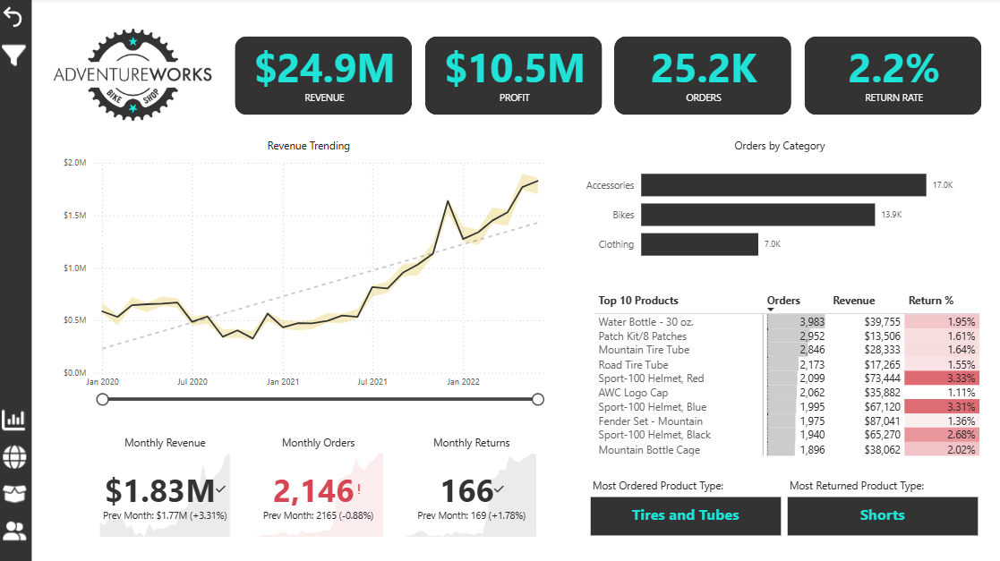
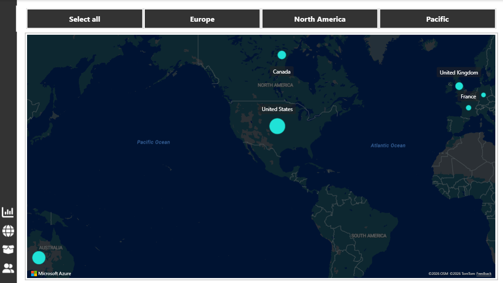
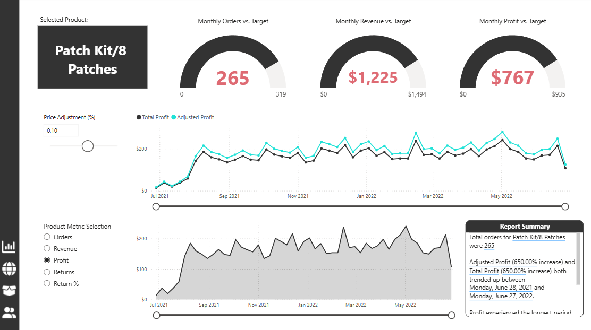
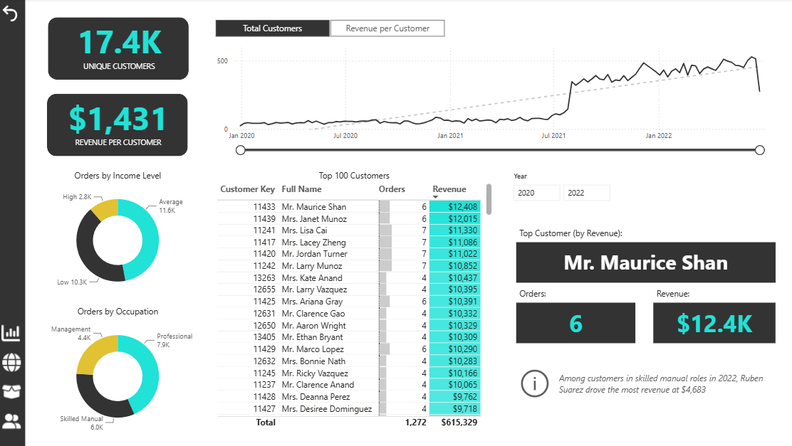

# AdventureWorks Power BI Dashboard

Power BI sales dashboard on the AdventureWorks sample dataset: KPIs, product and customer drill-downs, map, and DAX measures.

> **Data source:** AdventureWorks sample data (2020–2022) as distributed with the Maven Analytics AdventureWorks course. The raw CSV files are not included in this repository.

## My contribution

I wrote the DAX measures and designed the report visuals and pages (KPIs, trends, drill-downs, map, tooltips, navigation and the AI visuals) on top of the AdventureWorks data.

## Report pages

| Page | What it shows |
|---|---|
| Exec Dashboard | Orders, revenue, profit and return-rate KPIs with targets, a monthly trend, and top subcategories |
| Product Detail | Product-level metrics, gauges against targets, and trend/area charts with a metric selector |
| Customer Detail | Customer table, income and occupation breakdowns, and customer metrics |
| Map | Sales by territory (continent and country) |
| Q&A | Natural-language questions over the model |
| Key Influencers | AI visuals showing what drives key outcomes |
| Decomposition Tree | Drill-down of a metric by dimension |
| Category Tooltip | Hidden tooltip page with a category trend and detail card |

## Data model

Star schema with a dedicated measure table.

- **Fact tables:** sales (2020–2022) and returns
- **Dimensions:** Calendar, Product, Product Subcategory, Product Category, Customer, Territory
- **Parameter tables:** Customer Metric Selection, Product Metric Selection, Price Adjustment (%)
- **Measure Table** holding the DAX measures

## Key measures

Total Orders, Total Revenue, Total Profit, Total Returns, Return Rate, Total Customers, Average Revenue per Customer, Average Retail Price, Adjusted Profit, plus target and target-gap measures for orders, revenue and profit, and previous-month measures for orders, revenue and returns.

## Features

- Bookmarks and action buttons for page navigation
- Custom tooltip page
- Field-parameter style metric selection for customer and product pages
- What-if parameter for price adjustment
- Power BI AI visuals (Key Influencers, Decomposition Tree, Q&A)

## Tools

Power BI, DAX, Power Query

## Files

- `AdventureWorks_Report_FINAL_Dashboard.pbix`: the Power BI report (open with Power BI Desktop)

## Headline numbers (2020–2022)

| Revenue | Profit | Orders | Return rate |
|---|---|---|---|
| $24.9M | $10.5M | 25.2K | 2.2% |

## Screenshots

### Exec Dashboard

### Map

### Product Detail

### Customer Detail

